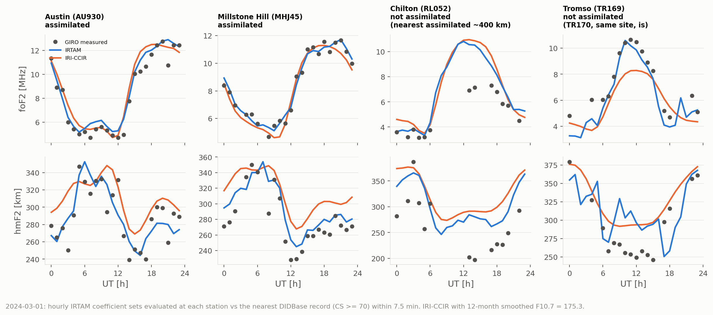

# IRTAM map evaluation: verification and a first validation

Date: 2026-09-23.  Code: `src/tss/l0_ionosphere/irtam_maps.py`,
`src/tss/l0_ionosphere/geomag.py` (`modip_deg`), `scripts/irtam_validation.py`.
Tests: `tests/unit/test_l0_irtam_maps.py`.

Two separate questions, answered separately.

1. **Verification.**  Does `irtam_maps.evaluate` compute what IRTAM's
   coefficients mean?
2. **Validation.**  How close is the evaluated IRTAM to measurement, and is it
   closer than the IRI-CCIR climatology it starts from?

## 1. Verification

**Against PyIRTAM.**  PyIRTAM 0.0.7 and PyIRI 0.1.7 (Forsythe et al. 2023,
2024, Space Weather) are the published Python implementation of the CCIR map
formalism and of IRTAM on top of it.  On both real coefficient files in
`tests/fixtures/irtam/`, at 500 random points and at the IRTAM time of
validity and 5 minutes off it, `evaluate` reproduces PyIRTAM's matrix product
to 1e-13 MHz, and `spatial_functions` reproduces PyIRI's 76 geographic
functions to 1e-12.  Six reference values are pinned in the tests so this is
checked on every run without PyIRTAM installed.

This shows the code computes what PyIRTAM computes.  It does not show that
PyIRTAM matches Lowell's own evaluation.  The validation below is the evidence
for that: a wrong basis or coefficient layout misses an assimilated station by
megahertz, and the evaluator misses Millstone Hill by 0.35 MHz rms.

**Modip.**  The spatial basis is expanded in Rawer's modified dip latitude.
`geomag.modip_deg` computes it from IGRF-14 (ppigrf 2.1.0) at 300 km at
mid-month, with a geodetic conversion.  PyIRI uses IGRF-13 extrapolated beyond
2020 and treats geographic latitude as geocentric.  Over a 2.5 x 5 degree global
grid the two differ by a median of 0.11 degrees of modip (95th percentile 0.63,
maximum 1.1), which moves foF2 by a median of 0.008 MHz (95th percentile 0.13,
maximum 0.30 MHz).  That is small next to IRTAM's error at an assimilated
station, so the choice of field model is not a limiting error.  The centred
dipole is not acceptable: its modip is 31 degrees wrong at 0 N 0 E, in the South
Atlantic anomaly.  `modip_deg` and `irtam_at` therefore require IGRF unless the
dipole is asked for by name.

**Physical sanity.**  Global maps from the 2024-03-01 12:00 UT and 2012-10-17
23:30 UT sets give foF2 of 3.2 to 16.6 and 2.2 to 13.6 MHz, with the maximum on
an equatorial anomaly crest (modip -24 and +13 degrees) at 20 to 21 h local
time, the post-sunset enhancement expected near equinox at high solar activity.

## 2. Validation, 2024-03-01

**Method.**  The 24 hourly IRTAM coefficient sets for foF2 and hmF2 were taken
from the static archive.  Each was evaluated at its time of validity at four
Digisonde sites and compared with the site's DIDBase record nearest that hour,
within 7.5 minutes, keeping records with autoscaling confidence 70 or better, or
manual scaling.  The baseline is IRI-CCIR evaluated by PyIRI with the 12-month
smoothed F10.7 for March 2024, 175.3 sfu, from NOAA SWPC's observed solar cycle
indices.

DIDBase's own `foF2p` column ("predicted value of foF2") was not used.  It gave
4.6 to 4.9 MHz for the Millstone Hill afternoon, where IRI-CCIR at the observed
solar flux gives about 11 MHz and the measurement is 11 to 11.7 MHz; it appears
to be computed with an inappropriate solar index.

**Independence.**  IRTAM assimilated the same 44 stations in every hour of the
day.  Millstone Hill and Austin are among them, so agreement there is
consistency, not validation.  Tromso TR169 is not assimilated, but TR170 at the
same site is, so it too is a consistency check between two instruments.
Chilton RL052 is not assimilated and the nearest assimilated station, Dourbes,
is about 400 km away: it is the only independent comparison here.  Of 20
unassimilated candidates queried, only these two had data that day.

| Station | Relation to IRTAM | n | foF2 rms (bias), IRTAM | foF2 rms (bias), CCIR | hmF2 rms (bias), IRTAM | hmF2 rms (bias), CCIR |
|---|---|---|---|---|---|---|
| Millstone Hill MHJ45 | assimilated | 22 | 0.35 (+0.05) MHz | 0.56 (-0.23) MHz | 18 (+12) km | 36 (+32) km |
| Austin AU930 | assimilated | 24 | 0.74 (+0.44) | 0.88 (+0.53) | 19 (+1) | 29 (+21) |
| Tromso TR169 | co-located with assimilated TR170 | 16 | 0.80 (-0.62) | 1.56 (-1.18) | 39 (+16) | 30 (+26) |
| Chilton RL052 | independent | 13 | 1.59 (+1.12) | 1.86 (+1.41) | 55 (+46) | 73 (+66) |

**What this shows.**  At assimilated sites IRTAM is close to the measurement
and roughly halves CCIR's hmF2 error.  At the one independent site the
improvement over CCIR is small: both models sit about 3.5 MHz above the daytime
measurements, and IRTAM's advantage comes mostly from the night.  hmF2 is
biased high at every site for both models, by 1 to 66 km.

**What it does not show.**  One day, four sites, one of them independent, 13
matched hours there.  It is enough to show the evaluation chain is right.  It
is not a characterisation of IRTAM's accuracy away from its stations, which is
what matters when IRTAM is used as truth for a topside pass over an ocean.
That needs many days and a leave-one-out design, or the published IRTAM
validations (Galkin et al. 2012, 2020), before any error figure is quoted in
the dissertation.

**Behaviour a simulation has to handle.**  Each 15-minute set is an
independent refit, so evaluating consecutive sets gives steps rather than a
smooth curve.  At Tromso, IRTAM foF2 goes 4.1, 6.2, 4.7 MHz at 19, 20 and 21
UT, a 2.1 MHz spike in one set with nothing in the measurements to match it.
Hour-to-hour hmF2 changes have a median of 11 to 13 km but reach 41 km at
Austin and 78 km at Tromso.  A
time-stepped simulation should either use one set per pass or interpolate
between sets, and say which.

## Reproducing

The inputs were cached under `results/irtam_validation/` (not committed):
`irtam/` holds the 48 archive files, `giro/` the DIDBase responses.

    python scripts/irtam_validation.py results/irtam_validation --f107 175.3 \
        --figure docs/figures/irtam_vs_giro_20240301.png \
        --note "TR169=not assimilated|(TR170, same site, is)" \
        --note "RL052=not assimilated|(nearest assimilated ~400 km)"

Needs ppigrf for modip and PyIRI for the CCIR baseline (`pip install ppigrf
PyIRI`); without PyIRI it reports IRTAM only.

## Found along the way

The DIDBase form at `giro.uml.edu/didbase/scaled.php` answers a POST with a
302 redirect to the GET service `https://lgdc.uml.edu/fastchar/getbest`.
`tss.data.giro` now calls that service directly (2026-09-23), by
characteristic name; the validation inputs above were fetched through the form,
which returns the same body.
